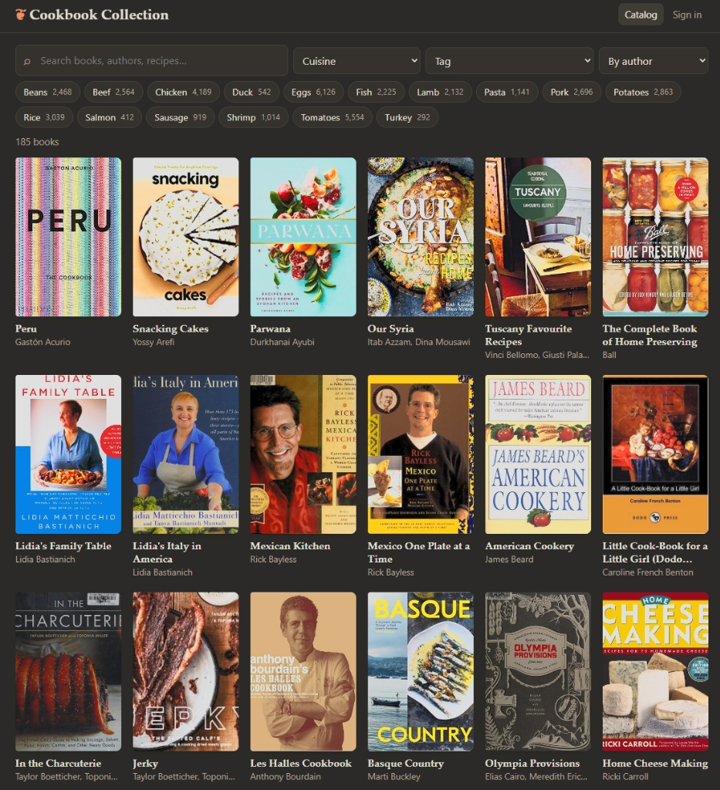

# Cookbook Collection

A family cookbook catalog: Flask + SQLite, running as one small service.
On the server it's called `cookbooks`: the service, `/opt/cookbooks`, `/var/lib/cookbooks`, `/etc/conf.d/cookbooks`, and port 8767.

- **Public** `https://cookbooks.example.com/` lets visitors browse and search books and recipe names, see which shelf each book is on, and (with Dinner Log linked) how many times each recipe was made.
- **Editors** `https://cookbooks.example.com/admin` sit behind Cloudflare Access. From there you can add books by barcode, edit them, import indexes, manage shelf locations, write your own recipes in the house book, and see ratings, notes and the want-to-try list.



## Install / upgrade

The installer targets **Alpine Linux** with OpenRC, e.g. a small container or VM. Build the one-file installer from this repo, copy it to the server, and run it as root:
```sh
sh installer/build.sh                 # -> dist/setup-cookbooks.sh
scp dist/setup-cookbooks.sh root@<server>:/root/
ssh root@<server> sh /root/setup-cookbooks.sh
```
The script is safe to run again. It replaces the app but keeps `/var/lib/cookbooks` (the database and covers) and `/etc/conf.d/cookbooks`. `sh setup-cookbooks.sh --uninstall` removes the app and service and keeps the data.

On a first install the database is seeded from `seed.json`, which holds the original collection's books and recipe names. To start your own catalog empty, replace `seed.json` with `{"books": [], "recipes": []}` before building.

**Time zone.** The daily limits (`PHOTO_DAILY_LIMIT`, `ASK_DAILY_LIMIT`) reset at local midnight, and a stock Alpine install runs in UTC, so they would reset at UTC midnight. To reset at your own midnight, set `TZ` in `/etc/conf.d/cookbooks` and restart:
```sh
vim /etc/conf.d/cookbooks            # TZ="America/Los_Angeles"
rc-service cookbooks restart
```
The installer adds `TZ=""` (empty: the server's own zone, so an upgrade changes nothing) and installs `tzdata`; without that package musl silently falls back to UTC. Don't export an empty `TZ` yourself: that means UTC and overrides `/etc/localtime`. For a local run, the line in `.env.example` is commented out for the same reason.

Health alerts post to a Home Assistant webhook. To use them, build with `HA_WEBHOOK_ID=… sh installer/build.sh`, or set `HA_WEBHOOK_ID` in `/etc/conf.d/app-ops` after installing.

## Cloudflare (hybrid public + private)

1. **Tunnel → Public hostname**: `cookbooks.example.com` → `http://<server IP>:8767`.
2. **Access → Applications → Add → Self-hosted**:
   - Domain `cookbooks.example.com`, **path `admin`**. Leave the root unprotected so the catalog stays public.
   - Policy: Allow → Emails → the people who should be able to edit, e.g. with a One-time PIN login.
   - Copy the app's **Application Audience (AUD) tag**.
3. On the server, edit `/etc/conf.d/cookbooks`. Set `CF_TEAM_DOMAIN` (e.g. `yourteam.cloudflareaccess.com`), `CF_AUD`, and optionally `ADMIN_EMAILS`. Then run `rc-service cookbooks restart`.

The path rule covers `/admin` and everything under it, including the `/admin/api/*` calls that do the editing. The app also verifies the Access JWT itself, so an unsigned request that reaches it through the tunnel can't edit.

### Editing from the LAN (optional, off by default)
Set `LAN_EDIT=1` to let requests that don't come through Cloudflare edit without signing in. Only turn it on if you trust every device that can reach the server. Three checks still apply:
- The client's address must be in `LAN_CIDRS` (default: loopback and the private ranges `10/8`, `172.16/12`, `192.168/16`, `fc00::/7`, `fe80::/10`). The app uses the connection's own address and ignores `X-Forwarded-For`.
- The URL must use the server's IP address, `localhost`, or a name you list in `LAN_HOSTS`. This blocks DNS rebinding, where a web page re-points its own hostname at your server.
- Every edit (POST/PUT/DELETE), LAN or Access, must come from the site's own pages: a request whose `Origin` is another site is refused with 403. This blocks cross-site request forgery. Scripts that send no `Origin` (curl, server-to-server) aren't affected. If the tunnel rewrites the `Host` header, the app falls back to `X-Forwarded-Host`; failing that, list your public origin in `ALLOWED_ORIGINS`.

Upgrading doesn't change an existing `LAN_EDIT` value. If `cloudflared` runs on the same server and you don't need LAN editing, also set `BIND=127.0.0.1` so the port isn't reachable from the network at all.

## Adding books
**Add book → Scan barcode** uses the phone camera. This needs Chrome on Android over HTTPS, so use the public HTTPS address rather than the LAN IP. The ISBN is looked up on Open Library, then Google Books, and the title, authors, publisher, year and cover are filled in.

For older books with no barcode, type the title and use **Find matches by title**.

## Importing a book's index
Open a book, choose **Import index**, and paste the index text. Google Lens on Android can copy text straight from a photo of the index page. You get an editable preview before anything is saved, and re-importing the same page skips duplicates.

## Photo index import
Set `ANTHROPIC_API_KEY` in `/etc/conf.d/cookbooks` and restart the service. In **Import index**, **📷 Take photo** opens the phone's camera and **Choose photos** picks several existing photos at once. Each photo is one page of the book's index; take them in order, as many as the index has (3 to 15 is typical). Every page is sent to Claude (grayscale, ≤2576px) and comes back as rows. A dense page (three columns, 250+ entries) takes a minute or two, so the pages are read as background jobs, a couple at a time, and the browser checks back until they're done; that way Cloudflare's 100-second limit doesn't apply. Under the photos, each page shows its state (waiting, reading, how many entries, or what went wrong) and a page that fails can be retried on its own without re-reading the others.

The pages are merged into one review table:
- A section that continues across a page or column break keeps its heading: entries at the top of a page with no heading of their own take the last heading of the page before, and are tinted so you can check them.
- Where two photos overlap, the repeated entries at the start of the second one are dropped.
- Page numbers written `p. 42`, `pag. 42` or `pp. 42–44` (common in Italian indexes) lose the prefix. Roman-numeral and lettered pages (`xii`, `12a`) are kept and marked ⚠ for a second look rather than dropped. Both also apply to pasted text.

The table header counts how many entries will be added and how many are already in the book; entries already present are unchecked. Add the lot with one tap. If a page is ever cut off, the entries read so far are kept and a warning tells you to photograph the rest of that page. The request asks for low effort (`ANTHROPIC_EFFORT=low`; set it empty for the model's default), since transcribing needs little reasoning and goes much faster without it.

| Variable | Default | Meaning |
|---|---|---|
| `ANTHROPIC_API_KEY` | empty (photo import off) | API key for reading index photos |
| `ANTHROPIC_MODEL` | `claude-sonnet-5-5` | Model for photo import |
| `ANTHROPIC_EFFORT` | `low` | Effort setting; empty for the model's default |
| `PHOTO_DAILY_LIMIT` | `100` | Index pages read per day across all editors (each is one model call with up to 16k output tokens); further pages get a clear refusal until local midnight. Retrying a page doesn't count twice. |

**Needs review → Not indexed yet** lists the books on hand that have no recipes in the catalog, each with an Import index link. The MCP's `search_books` has the same filter (`indexed: false`).

## Dinner Log link (optional)
Dinner Log, a companion meal-journal app, serves its cooking history at `GET /api/history` behind a token. Cookbook Collection pulls it and matches each dinner to a book and recipe.
- **Setup:** generate a token (`openssl rand -hex 32`), set it as Dinner Log's `HISTORY_TOKEN`, and in `/etc/conf.d/cookbooks` set `DINNERLOG_TOKEN` to the same value and `DINNERLOG_API_URL` to Dinner Log's **private** address, e.g. `http://127.0.0.1:8000` when both run on the same server. The token travels in plain HTTP there, so keep it on loopback or a private network, or use https. Redirects are refused, so the token never follows one to another address.
- **Matching:** dinners logged from here (the 🍽 link, Dinner Log's **Log tonight** on a pick, or its recipe picker) carry this catalog's stable book and recipe uids, plus the integer ids, and match exactly. Older dinners, and ones typed in by hand, are matched to a book by title, then to a recipe by page number and name. The full order, and what each side stores, is in [docs/seam.md](docs/seam.md).
- **Upgrading to uids:** either app can go first. Afterwards, run Dinner Log's `backfill_uids` (dry run first) to stamp uids on dinners logged before them; see its README. **Stats → Dinner Log** (`/admin/api/dinnerlog`, field `resolved`) shows how many dinners matched at each step, and the service log prints the same counts on every rebuild.
- **Freshness:** pages never wait on Dinner Log. When the stored history is more than a minute old, the next page that needs it starts a fetch in the background (one at a time across workers), and a reload shows the result. If Dinner Log doesn't answer, the last history it sent is kept and fetches pause for five minutes. **Stats → Dinner Log** shows when it last answered and any error, and opening it fetches right away.
- Editors see each recipe's times made, last made and average rating ("made 3× · last Oct 12 · 8/10"). The public book page shows only the times made ("made 3×"): `PUBLIC_RECIPE_COOKED` in `app.py` is the list of history fields the public gets. **Stats** shows the overall picture.
- When a name doesn't match, pick the book once on the Stats page. When a dinner matches the book but not a recipe, link it or add it as a recipe from the book's page.
- **Dinner photos:** a photo shared from Dinner Log (its **Show on the cookbook page** box) appears on its recipe here, in the book's photos and the public gallery, without being uploaded twice. Nothing to set up beyond the link above. See *Photos from Dinner Log* under *Photos of what you made*.
- **Upgrading from a version that read Dinner Log's database file:** upgrade and configure Dinner Log first, then this app. The installer removes the `cookbooks` user from the `dinnerlog` group; `DINNERLOG_DB` is no longer used. Cooking history already here is kept until the first fetch replaces it.

## Eat Your Books import
**More → Import from Eat Your Books** accepts both of EYB's CSV exports.
- **Bookshelf:** books are matched by ISBN, then by title and author. You review the proposals, and can pick another book or skip any row. Matched books gain their ISBN, format and EYB title. Books you don't have here yet are added and land on Needs review. Re-importing is safe.
- **Recipes:** import EYB's 200-row exports one at a time, or all of them combined into one file. Recipes already present are skipped, including re-worded copies of recipes entered another way on the same page. Books not in the catalog can be picked, added as new, or skipped. EYB's title for each book is remembered, so later imports match on their own.
- **Fetch covers & details** then looks up every book with an ISBN on Open Library and Google Books. It fills in the cover, year, publisher and subtitle only where they're missing.

## Ingredient tags
EYB's ingredient search finds far more recipes than titles do: searching "chicken" there returns everything that uses chicken, stock included. To bring that in, search an ingredient on EYB, export the results, and import them under **More → Import from Eat Your Books → Ingredient lists** with the ingredient's name.
- Recipes already in the catalog get tagged; ones that aren't yet get added.
- A book has one cuisine. To file it under a second one, add a tag with that cuisine's name: *Provincetown Seafood Cookbook* with cuisine American and tag Portuguese shows up when you filter by either. Stats count each book once, under its own cuisine.
- The catalog shows a chip per ingredient. Picking one lists the books that use it, with how many matching recipes each has; open a book to see those recipes. Chips combine with search words, cuisine and tag, which narrow both the books and the counts.
- Search matches every word against recipe names *or* ingredient tags, so "chicken curry" finds curries that use chicken.
- The tags are a few major ingredients, not a full ingredient list. Only some recipes carry them, so picking an ingredient (a chip, or `ingredient` in the MCP) finds recipes tagged with it **or** with it in the title. A more specific ingredient uses the tag inside it: "ground beef" uses Beef, "egg" uses Eggs, "cherry tomatoes" uses Tomatoes. One with no tag, like "turkey", matches titles only. When two tags apply because one contains the other ("sweet potatoes" → Sweet potatoes and Potatoes), only the more specific one is used. Name tags with the fewest words people would type: "Collards", not "Collard greens". The MCP's `search_recipes` lists the tags and says which one it used.
- Re-importing a list is safe. Removing an ingredient deletes only the tag, not the recipes.
- **Ranking:** search results (on the site and in the MCP) come best first. A word in the recipe's title or index heading counts most, then a specific tag (Leeks, Chicken pieces), then a broad one. So for "chicken leeks", "Risotto with Chicken, Leek and Garlic" comes before dishes that only got there through tags. On the site, each book's recipes stay together, with the books holding the best matches first. Plural words also find singular titles ("leeks" finds "Leek and potato soup"). A title that names the ingredient only as its stock or fat ("Chicken stock", "Basic chicken broth", "Duck-fat potatoes") ranks like a minor form, unless the search asks for the stock.
- **Minor forms:** EYB's list for an ingredient includes recipes that only use a minor form of it. Its "chicken" list includes recipes that only use chicken stock, "tomatoes" anything with a spoonful of tomato paste, and "rice" dishes seasoned with rice wine. Import those forms as hints named **<main tag> <form>**, where the form is stock, broth, fat, paste, sauce, vinegar, wine, flour or starch: Chicken stock, Tomato paste, Rice wine, Duck fat, Fish sauce, Bean paste… Each is recognized from its name. A recipe tagged with the main tag *and* one of its minor forms, with no mention in its title and no more specific tag, then ranks low, because it may use only that form. It isn't dropped, since most chicken soups use both meat and stock. A search that names the form ("tomato paste") ranks those recipes normally. Several EYB searches can feed one tag: type the same name when importing "white stock" and "chicken broth" as Chicken stock. Don't name a tag this way unless you want the demotion; a "Tomato sauce" hint would demote tomato dishes. To mark recipes that use the meat itself, import the cut lists (breasts, thighs, wings…) under one hint such as **Chicken parts**.
- **A zip of lists:** **Choose a zip of CSVs** imports many EYB ingredient exports at once. The preview has one row per file, with the tag name guessed from the file name ("Kale - all pages combined.csv" → Kale), a Search hint box, and counts. Files given the same tag name are combined, so typing "Chicken stock" for "chicken broth" and "white stock" puts both in one tag. To set this up in advance, add a `tags.csv` to the zip:
  ```
  file,tag,hint
  chicken broth,Chicken stock,yes
  white stock,Chicken stock,yes
  ground beef,Ground beef,yes
  ground beef,Beef cuts,yes
  ```
  `file` is the file's name, with or without " - all pages combined.csv". A file can be listed twice to feed two tags. `hint` is `yes` (no chip) or `no` (a catalog chip), and defaults to yes. Rows naming a file that isn't in the zip are reported. Only books already in your catalog are used: recipes from other books are skipped and listed, and a zip import never adds books.
- **Search hints:** for everyday ingredients like zucchini, kale or collards, tick **Search hint only** when importing; it's ticked for a new tag. A hint tags recipes just like Beef or Chicken. Searching "zucchini", the ingredient filter and Claude (MCP) all find them, but it gets no chip on the catalog page. The MCP lists hints separately from the major tags. **Show chip / Hide chip** in the ingredient list switches a tag between the two kinds.
- If an export's accented letters were lost before import ("tud�usi" for "tudòusi"), the rows are recognized as recipes already in the catalog instead of being added again. Garbled copies already in the catalog are merged into their correctly spelled twin on the same page when the app starts, keeping their tags, stars, notes and Dinner Log links. Ones with no twin are listed on **Needs review** to retype.

## Recipes from websites (NYT Cooking and others)
Recipes from sites like NYT Cooking or Serious Eats are saved the way a cookbook's index is: a name and a link. Each site gets its own entry in the catalog, made the first time one of its links is saved. Opening a recipe takes you to the site, where you're signed in to your subscription.
- **More → Recipes from websites:** paste one link or many, in any text. You get a preview with editable names before anything is saved. Links that aren't recipe pages are skipped, and links already saved are recognized even with tracking parameters added.
- **Whole NYT Cooking Recipe Box:** drag **Copy recipe links** from that page to your browser's bookmarks bar. Open your Recipe Box and scroll to the bottom so it's all loaded, then click it and paste the result. It only reads links already on the page, in your own browser.
- **From your phone:** install the editor page to your Android home screen (Chrome → Add to Home screen). **Share → Cookbook Collection** from the NYT Cooking app or a recipe page then opens the preview with that link, using the site's own title.
- **Names:** no page is downloaded from the site, so names come from the link ("1017256-french-onion-soup" → "French Onion Soup"). Fix any in the preview, or later with ✎.
- **Where they show up:** web recipes appear in search, ingredient chips (by title), Want to try and Cook suggestions, with **Open ↗** instead of a page number. Dinner Log dinners whose source holds the recipe's link count as cooking it.
- **Editors only:** online sources aren't shown in the public catalog, public search or the public MCP. They aren't counted as cookbooks either; Stats shows them separately.

## House recipes (our own)
Recipes you develop yourselves live in one **house book**, a book like any other with full ingredients and steps.
It is created on first start (titled by `HOUSE_BOOK_TITLE`, default "House Recipes"; rename it in the editor
afterwards, the setting only names a new one) and can't be deleted or shelved.
- **Write one:** open the house book (**More → House recipes**, or `/admin#/house`) and tap **New recipe**. The editor
  has name, description, servings, yield, prep/cook/total minutes, methods, equipment, notes and inspiration, then
  ingredient and step rows you add, move (↑/↓) and remove. **+ Section** adds a heading ("For the sauce") that applies
  to the rows under it. Enter in an ingredient's name moves on to the next row. Quantities are kept as typed
  ("1 ½", "2-3", "a pinch") and read as numbers where they are numbers, for scaling.
- **Cook from it:** the recipe page scales by servings (or ½×–3×), lets you tick off ingredients and steps, runs a
  timer per step, and can keep the phone's screen on while it's open.
- **Who sees it:** the house book is **members only**: only someone signed in (the editors behind Access) sees it or its
  recipes. It is left out of every public view, the public search, the public MCP and every public count. Every book
  has a **Visible to** setting (Everyone / Signed-in members only) on its edit page, so you can publish the house book,
  or hide a cookbook. Recipe websites stay editor-only whatever the setting.
- **Search:** house recipes are found by their ingredients as well as their names: catalog search, ingredient chips,
  the Cook page, Dinner Log's Pick for tonight, the MCP and Ask. MCP `get_recipe` returns one in full.
- **Start one from another app:** link to `/admin/recipe/new?title=<name>&return=<url>`. The editor opens with the
  name filled in; after saving, the browser goes to `return` with `cookbook_book_uid` and `cookbook_recipe_uid` added
  to its query, but only if `return` is a path on this site or its origin is listed in `RETURN_URL_ORIGINS`
  (e.g. `https://dinner.example.com`). Anything else is ignored and the recipe opens here instead. (`/admin#/recipe/new?…`
  works too; the path form keeps its query through the Access sign-in.)
- **Read API** (for Dinner Log; under `/admin/api` with `READ_TOKEN` or a signed-in editor, and under `/api` only if the
  house book is public):
  ```
  curl -H "Authorization: Bearer $READ_TOKEN" 'http://127.0.0.1:8767/admin/api/house/recipes?q=ragu&limit=50'
  # {"book": {"id", "uid", "title"}, "count": 3, "recipes": [{"id", "uid", "title", "updated_at"}], "next_offset"?}
  curl -H "Authorization: Bearer $READ_TOKEN" 'http://127.0.0.1:8767/admin/api/house/recipes/<uid>'
  # {"uid", "title", "book": {...}, "updated_at", "detail": {...}, "ingredients": [...], "steps": [...]}
  ```
  `GET …/house` gives the house book's id and uid; `GET …/recipes/by-uid/<uid>` returns any recipe the caller may see.
- **Backups:** the JSON export carries each house recipe's `detail` (with its ingredients and steps), and the importer
  restores it. A restore maps the file's house book onto this catalog's own, and `--replace` never deletes it.

| Variable | Default | Meaning |
|---|---|---|
| `HOUSE_BOOK_TITLE` | `House Recipes` | Title of the house book when it is first created |
| `RETURN_URL_ORIGINS` | empty | Origins (`scheme://host[:port]`, comma separated) the recipe editor may return to after a save; paths on this site are always allowed |

## Family wish list (optional)
If a companion wish list app runs on the same server, set a book's status to **Want to buy** and use **Add to a wish list…** on its page. It adds the book to the chosen person's list with a shopping link built from the ISBN (`WISHLIST_BOOK_URL`). It does this through the wish list app's own API on localhost, so the wish list itself is unchanged. Purchase status is never shown here, so there are no spoilers.

## Dinner Log ⇄ Cookbook Collection
- **Stable ids:** every book and recipe has a `uid` (32 hex characters) next to its numeric `id`. The number is a SQLite rowid and can be reused after a delete; the `uid` never is, so anything that remembers a book outside this database should store the `uid`. Both appear in `/api/books`, `/api/books/<id>`, `/api/recipes` and the exports, and `GET /api/books/by-uid/<uid>` returns the book (404 if it's gone). Databases from before this field get one for every row on the next start.
- **In Dinner Log** (set its `COOKBOOK_URL`, or `COOKBOOK_API_URL` for a private address): choosing a cookbook offers that book's indexed recipes, and picking one fills in the page and the dinner name. Dinner Log reads them from the public `/api/books` endpoints, and its form works as before if this app is down.
- **In Cookbook Collection:** set `DINNERLOG_URL` and each recipe gets a 🍽 link that opens Dinner Log's form already filled in, including this recipe's ids so the dinner matches exactly.
- **Pick for tonight (in Dinner Log):** Dinner Log asks `GET /admin/api/pick` for recipes to suggest, filtered by ingredients to include or leave out and by mode: `fav` (rated 8+ and not made in the last `rest` days, default 21), `new` (never cooked) or `any`. Ingredients match the way the ingredient chips do: tagged with it, or in the title. Leaving one out is best effort, since tags cover only some recipes; the response's `title_only` lists ingredients that have no tag and so match titles alone. Starred recipes come up more often, and favorites more often the higher they're rated.
  ```
  curl -H "Authorization: Bearer $READ_TOKEN" \
    'http://127.0.0.1:8767/admin/api/pick?mode=new&with=chicken,lemon&without=pork&n=5'
  ```
  The route is private (it returns ratings and cooking history). Editors reach it through Access; Dinner Log uses `READ_TOKEN`, which the installer generates in `/etc/conf.d/cookbooks`. The token only opens read-only routes, never edits. Call it over localhost rather than the public address, which Access protects.

## Accents and other alphabets
- Search ignores case and accents, and also special letters: "creme brulee" finds *Crème brûlée*, "pepin" finds Jacques Pépin, "oeufs" finds *Œufs*, "smorrebrod" finds *Smørrebrød* and "strasse" finds *Straße*. The same applies to ingredient tags, the filter on a book's page and Dinner Log title matching.
- Chinese, Japanese, Korean and Thai don't put spaces between words, so a search in those scripts matches anywhere in a recipe name or book title.
- Authors, tags and ingredients that differ only by accents or case are treated as one. "Jose Andres" from an EYB export joins an existing "José Andrés", and an accented spelling replaces an unaccented one.
- Saved text is normalized, so an "é" typed on a Mac matches one from a CSV, and fi/fl ligatures from PDFs or photographed indexes are spelled out.
- The EYB import repairs text garbled by a round-trip through Excel ("Crème" → "Crème"). **Download CSV** includes a byte-order mark so Excel opens accents correctly.
- The search index stores folded text, using a `fold()` SQL function the app registers on every connection. It's rebuilt on each start. Edit recipes through the app rather than the `sqlite3` command line, which doesn't have `fold()`.

## Book ratings
Editors can give each book an overall rating of 0–5 stars, in half stars.
- On a book's page, tap the left half of a star for a half star or the right half for a whole one. The arrow keys also change it, and **Clear** removes it.
- The **Edit book** form has the same rating as a menu.
- Ratings appear on the catalog cards, and **Top rated** sorts by them, with unrated books last. Like recipe ratings, they're visible only to editors, not the public catalog.
- The rating is also in the CSV export and in the private MCP's book results.

## Photos of what you made
Editors can attach photos of a dish to the recipe it came from.
- On a book's page, tap **📷** on a recipe row and choose **Add photos**. On a phone this offers the camera or the gallery, and you can pick several at once.
- The date is read from each photo. Set **Cooked on** to override it, and add an optional caption.
- The book's page shows every photo under **What we've made**, with the recipe name and page. Tap one to view it full size, and use ‹ › or the arrow keys to step through them. The 📷 on a recipe row shows how many photos it has.
- **Photos** in the menu is a public gallery of every dish photo, newest first by the day it was cooked, with filters for cookbook and year. Each card links to its book; tap a photo to step through the filtered set full size.
- Viewing is public: the gallery (`/api/photos`) and the image files (`/photos/<file>`) need no sign-in, so captions are public too. Photos of recipes from websites stay editor-only, like the websites themselves. Adding, editing and deleting photos happen under `/admin`, behind Cloudflare Access. Older `/admin/photos/` links still work.
- Image files are served with a one-day cache lifetime. If a CDN in front of the app caches them (Cloudflare caches `.jpg` by default), a deleted photo can stay reachable at its URL until that copy expires; purge the URL in your CDN if that matters.
- Each upload is resized to at most 2048px, plus a 480px thumbnail, and saved as JPEG in `/var/lib/cookbooks/photos`. Re-encoding drops the EXIF data, including any phone GPS location.
- Deleting a photo, recipe or book deletes its files. The nightly backup copies `photos/` to `BACKUP_TARGET`, and **Download JSON** lists each recipe's photo files.
- Uploads (covers, dish photos, index photos) are accepted as JPEG, PNG or WebP; other formats are refused rather than decoded. iPhone HEIC photos work if the `pillow-heif` Python package is installed. Without it, Safari normally converts them to JPEG when uploading.

### Photos from Dinner Log
With the Dinner Log link set up, photos shared there are imported here on their own: Dinner Log's history lists each dinner's shared photos, and after each history fetch this app copies the ones whose dinner matches a recipe (by the same rules as cooking history), in the background.
- **What becomes public:** the same as an upload. A copy on a cookbook's recipe is public (gallery and image file); on a recipe from a website, or in a house book that isn't public, it stays editor-only. Dinner Log's box says so where it's ticked; it's off by default for every photo.
- **How it's stored:** each photo is fetched once with `DINNERLOG_TOKEN` (no redirects, no proxy, at most 10 MB), decoded as JPEG/PNG/WebP only, re-encoded like an upload (EXIF dropped again; Dinner Log has already stripped it), under a name of its own. **Cooked on** is the dinner's day. Editors see *from Dinner Log* next to it; the caption and date can be edited as usual.
- **Staying in step:** every fetch reconciles. A photo unshared or deleted in Dinner Log, or whose dinner was deleted or no longer matches a recipe, loses its copy here (row and files). A dinner that now matches a different recipe moves its photos there. Removals come first and aren't limited; new copies are limited to 8 per fetch (and 45 seconds), so a large first batch arrives over a few minutes of normal use.
- **Deleting here wins:** deleting an imported photo in the editor keeps it from coming back, even if it's shared again in Dinner Log. A file that can't be read is skipped the same way, and logged.
- **Caching:** imported photos are served with a 10-minute cache lifetime (uploads keep a day), so after an unshare a browser or CDN copy expires within minutes. The page itself stops listing the photo after the next fetch, which starts with the next page view once the stored history is a minute old.
- **Backups:** the photo files and rows are in the nightly backup like uploads. **Download JSON** marks each imported photo with its Dinner Log file (`dl_file`), so a restore from it doesn't import them a second time.

## Shelf locations
Where each book lives is a tree of locations of any depth: room › area › shelf, say `Kitchen › Pantry › Shelf 2`. A book is in at most one.
- **Manage** them under **More → Shelf locations**, or with **Manage** beside the Location picker on a book's edit form (editors only). Tap a location to add one inside it, rename it, move it, reorder it among its siblings, or delete it. A location can't go inside itself or anything below it, and two siblings can't share a name (compared ignoring case and accents). Deleting asks first and says how many books become unshelved and how many sub-locations go with it; the books themselves stay.
- **Public view:** books show their location on the card and on the book page, where it links to the catalog filtered to that location. Filtering by a room includes every shelf below it (`?location_id=`). The Location filter appears only once a book has a location, and lists only locations that hold a public book, directly or below. There is no "(none)" bucket. **Locations are public on purpose**: anyone who can browse the catalog can see the room and shelf names that hold your books. Don't name a location anything you wouldn't put on the public page. Online recipe sources (`kind='online'`) are editor-only, can't be shelved, and never contribute to the public list.
- **API:** `GET /api/locations` (public: only locations with public books) and `GET /admin/api/locations` (all of them). Each has `id`, `parent_id`, `name`, `path`, `depth`, `sort_order`, `n` (books on it or below it) and `direct` (books on it itself); the public counts include only public books. Books carry `location_id` and `location_path`; `/api/books` and `/api/recipes` accept `location_id`. Editors use `POST /admin/api/locations`, `PUT` and `DELETE /admin/api/locations/<id>` and `POST /admin/api/locations/reorder` (`{parent_id, ids}`); a book's `PUT` takes `location_id` (`null` unshelves it).
- **Upgrading:** the first start after this version turns the old free-text location into locations, once. Spellings that differ only by case, accents or stray spaces become one root location named with the commonest spelling, and every book with one is shelved there. Text is never split: `Office, top shelf` becomes one location with exactly that name, and you can then move and rename things into a tree in the manager. The old `books.location` column is kept but no longer read or written, so rolling back to the previous version works; shelf edits made after upgrading aren't visible to it. The numbers (locations created, books shelved, names that look like paths) are recorded in the `meta` table under `locations_migrated`.
- **Export / import:** the JSON and CSV exports give each book's path in `location` (`Kitchen › Pantry › Shelf 2`), and importing rebuilds the tree from it, creating missing levels and reusing existing ones. Only the `›` separator is read as a path. Empty locations and sibling order aren't in the export, and the export format `version` is unchanged.

## What should we cook? / Stats / shelf
- **Cook** (`/admin#/cook`, editors only) suggests what to make. Enter one or two ingredients (matched like the ingredient chips: tagged with it, or in the title), pick **Never made**, **Not lately** (made before, but not in the last 90 days), **Want to try** (starred, not yet made) or **Any**, and optionally a cuisine. Each result shows the book, page, when you last made it and how often, a ★ if it's on the want-to-try list and the newest photo if there is one; tapping it opens the book scrolled to that recipe. **Shuffle** reorders the same set. Behind it is `GET /admin/api/cook` (`mode`, repeatable `with`, `cuisine`, `limit` up to 50, `offset`, `seed`), which uses the same ranking as `/admin/api/suggest`, the MCP `suggest_recipes` tool and `/admin/api/pick`.
- **Pulled out / Put back** on a book's page tracks books that are off the shelf.
- **Stats → The collection** counts the books you own by author, publisher, tag, book rating, decade published and format. Publisher spellings that differ only by case or accents are counted together. Each list shows the top 12, with the rest under **All**, and tapping an author, publisher or tag opens those books in the catalog.

## MCP (use the catalog from Claude)
- `https://cookbooks.example.com/mcp` is public and read-only: search books and recipes, get a book with its index, get a recipe (`get_recipe`). It sees only books visible to everyone.
- An `Authorization: Bearer <MCP_TOKEN>` header on `/mcp`, or `https://cookbooks.example.com/mcp/<MCP_TOKEN>` for clients that can only take a URL, adds ratings, cooking history, `suggest_recipes`, `cooking_stats`, `set_want_to_try`, and `update_book` (sets a book's cuisine and adds or removes tags, nothing else).
- The token is generated on install and lives in `/etc/conf.d/cookbooks`. Treat the private URL like a password.
- `/mcp` must stay **outside** the Access app, which only protects `/admin`.
- Prefer the header. The app keeps the token out of its own access log (`/mcp/<redacted>`), but a token in the URL still shows up in Cloudflare's request logs and anywhere the URL is pasted. The token is `MCP_TOKEN` in `/etc/conf.d/cookbooks`; the installer no longer prints it.
- `get_book` returns up to 200 recipes per call (`limit` up to 500) with `recipe_count` and `next_offset`, so a long index is read in pages. A JSON-RPC batch may hold at most 20 requests.
- `search_recipes` returns the best matches first, the `total`, and `next_offset` when there are more; each recipe's `match` is "title" when every word is in its title, or says per word where it came from: "chicken: title, leek: tag", "chicken: may be only chicken stock", or "chicken: only as “chicken stock” in the title". The server's instructions tell Claude that some books have no page numbers and that the recipe and book title are enough.

## AI search (Ask)
Editors can ask the catalog questions in plain language ("a weeknight lamb dish from a book we cook from a lot") with the **Ask** button at the top of the editor (`/admin#/ask`). Claude searches the catalog through the same read-only tools as the private MCP (never the write tools) and lists real recipes and books, with names and pages taken from the database. An empty catalog search offers **Ask instead →**. Questions are editor-only. If you're signed in through Access, the public catalog also shows the **Ask** button, which opens the same panel under `/admin`; to find out, the page makes one request to `/admin/api/me` per browser session (plus `/admin/api/features` for an editor) and remembers the answer, and anonymous visitors see nothing new. That check only decides whether to show the button: `POST /admin/api/ask` stays behind Access and `@editor_required`, and there is no public ask endpoint. It is **off** until a key is set.

Setup:
1. Create an API key in the Anthropic Console, ideally in its own workspace with a monthly spend limit.
2. Set `ANTHROPIC_SEARCH_KEY` in `/etc/conf.d/cookbooks` and restart (`rc-service cookbooks restart`). Without it, `ANTHROPIC_API_KEY` (photo import) is used if set.

| Variable | Default | Meaning |
|---|---|---|
| `ANTHROPIC_SEARCH_KEY` | empty, falls back to `ANTHROPIC_API_KEY` | API key for Ask |
| `ANTHROPIC_SEARCH_MODEL` | `claude-haiku-5-5` | Model for Ask |
| `ASK_DAILY_LIMIT` | `200` | Questions per day across all editors; further ones get a 429 until local midnight |

- Cost: typically about $0.003 per question. Each question is bounded in tokens: each tool result sent to the model is capped at 12,000 characters, and once a question has used 40,000 input tokens the next round must give its answer, so input stays near 40,000 tokens plus that one final round (at most 5 rounds), and output is at most 2,048 tokens per round. Set a monthly spend limit on the key in the Anthropic Console; that is the hard cap.
- Limits: 5 questions per thread, 500 characters per question, 60 seconds per question.
- Data sent to the Anthropic API: the thread's questions and earlier answers, plus the catalog search results the model asks for. These include editor-only data (ratings, cooking history, web recipes), as the private MCP does. Photos are never sent.
- Stored locally: only a log row per question (`ask_log`: time, editor, rounds, token counts, status). The question text is not stored.

## Backups and alerts
The ops scripts cover Cookbook Collection and, if they're installed on the same server, Dinner Log and the wish list. Their settings live in `/etc/conf.d/app-ops`. Alerts name the server by `HOST_LABEL` (default: its hostname).

Older versions named these files after the container (`/etc/conf.d/ctNNN-ops`, `/var/backups/ctNNN`, `ctNNN-backup`, …). The installer moves them to the names above on upgrade and keeps the old `ctNNN-notify` command as a link, in case another app still calls it. It never overwrites a file that already exists under the new name. The alert text changes too, so check any Home Assistant automation that matches on it.
- `/etc/periodic/daily/app-backup` takes consistent SQLite snapshots into `/var/backups/apps`, kept `KEEP_DAYS` days. Restore one with `app-restore` (see [Backup / restore by hand](#backup--restore-by-hand)).
- Set `BACKUP_TARGET` to a mounted folder on other storage, e.g. an NFS share from a NAS. Snapshots plus photos and covers are copied there too.
- **Without `BACKUP_TARGET` only the databases are backed up.** If photos or covers exist, the nightly run logs `WARNING: image files are not backed up: 212 in /var/lib/cookbooks/photos (212)…` to `/var/log/app-ops.log`, and the installer's summary says the same (`app-backup --check-images` prints it on demand). One alert goes to the webhook, named `Backup coverage`, when that state begins, not every night; a matching "up" follows once `BACKUP_TARGET` is set. If `HA_URL` wasn't set at that moment, the alert was only logged and won't repeat until the state has cleared and returned.
- `/etc/periodic/15min/app-health` checks each app. After ~30 minutes down it sends one alert to a Home Assistant webhook automation, and one more on recovery. Set `HA_URL` and `HA_WEBHOOK_ID` to turn alerts on.
- `GET /healthz` needs no login and is what `app-health` polls. It runs a trivial query, queries both full-text indexes (when SQLite has FTS5) and checks that the data folder is writable with free space. Healthy: `200 {"fts":true,"ok":true}`. Otherwise `503 {"fts":false,"ok":false,"reason":"db"}` where `reason` is `db`, `fts` or `data-dir`; that is all it reveals, and details go to `/var/log/cookbooks.log`.
- The app runs under `supervise-daemon`, so a crash restarts it automatically.
- **Logs** (`/var/log/cookbooks.log`, the gunicorn access and error log, and `/var/log/app-ops.log`) are rotated by `logrotate` from the daily cron job, using `/etc/logrotate.d/cookbooks`: the gunicorn log weekly or once it passes 10 MB, eight kept; the ops log monthly or past 5 MB, six kept; both compressed. The gunicorn log is rotated with `copytruncate`, so the service isn't restarted; the price is that a line written in the instant between the copy and the truncate can be lost. The installer writes that file only if it doesn't exist, so edit it freely: an upgrade never overwrites it. Check a change with `logrotate -d /etc/logrotate.d/cookbooks`.

## Backup / restore by hand
Copy `/var/lib/cookbooks/` (`cookbooks.db` + `covers/`), or use **More → Download JSON**.

### Restore from a SQLite snapshot
`app-restore` (installed in `/usr/local/bin`) does the whole job. Run it as root:
```sh
app-restore --list                  # snapshots, newest first
app-restore --dry-run 2026-11-10    # checks the snapshot and prints the plan; changes nothing
app-restore 2026-11-10              # restores it
```
```
Snapshots in /var/backups/apps, newest first (restore one by name, or use "latest"):
  2026-11-10                                       212K
  2026-11-09                                       210K
  cookbooks-before-upgrade-20261105-101500         205K
```
The name is `latest` (the newest nightly snapshot), a date, the name of a safety copy shown by `--list`, or the path of a `.db.gz` file, for example one in `BACKUP_TARGET/db/<date>/`. A real run:
1. checks the snapshot while the service is still running (gzip test, `PRAGMA integrity_check` on a copy), so a bad snapshot costs no downtime;
2. stops the service and saves the database it is about to replace as `/var/backups/apps/cookbooks-before-restore-<time>.db.gz` (a damaged database is kept as a raw copy);
3. swaps the snapshot in and removes the stale `-wal` and `-shm` files (a leftover `-wal` from the old database would be replayed onto the restored one);
4. fixes ownership, runs `PRAGMA integrity_check` on the result, starts the service and waits for `/healthz`.

If something fails before the swap, the service is started again with the old database untouched. If the restored database fails its integrity check the service is left stopped, and the message says how to go back (`app-restore <the before-restore copy>`). Only the database is restored: photos and covers stay as they are, so copy those back from `BACKUP_TARGET/files/cookbooks/` yourself if you lost them. Restoring a snapshot from an older version is fine: the app migrates the database when it starts.

By hand, the same steps are:
```sh
rc-service cookbooks stop
gunzip -c /var/backups/apps/<date>/cookbooks-cookbooks.db.gz > /var/lib/cookbooks/cookbooks.db
rm -f /var/lib/cookbooks/cookbooks.db-wal /var/lib/cookbooks/cookbooks.db-shm
chown cookbooks:cookbooks /var/lib/cookbooks/cookbooks.db
rc-service cookbooks start
```

### Restore from a JSON export
The JSON from **More → Download JSON** (or `GET /admin/api/export.json`) can be loaded back with the
importer. It needs no extra packages. Stop the service first so nothing writes while it runs:
```sh
rc-service cookbooks stop
cd /opt/cookbooks
# Look first: prints what would be inserted, updated, skipped or deleted, and changes nothing.
DATA_DIR=/var/lib/cookbooks python3 -m importer /path/to/export.json --dry-run
# Then do it. --photos is optional: a folder holding covers/ and photos/ subfolders (or the files directly).
# A BACKUP_TARGET copy works as is: <BACKUP_TARGET>/files/cookbooks
DATA_DIR=/var/lib/cookbooks python3 -m importer /path/to/export.json --photos /path/to/backup/files/cookbooks
rm -f /var/lib/cookbooks/cookbooks.db-wal /var/lib/cookbooks/cookbooks.db-shm
chown -R cookbooks:cookbooks /var/lib/cookbooks
rc-service cookbooks start
```
- Shelf locations: a book's `location` path is rebuilt as locations (see Shelf locations). A book with no
  `location` key keeps its shelf, `null` unshelves it, and online books are never shelved.
- Books and recipes are matched by `uid`: a known uid is updated, an unknown one is inserted with that
  uid. Exports without uids (older versions) match by ISBN, then by title plus first author.
- The default is a **merge**: nothing is deleted. `--replace` also deletes books (and the recipes and
  photo rows of matched books) that are not in the file, after printing what it will remove. Use
  `--dry-run --replace` to preview. Only database rows are deleted, never files.
- The import is one transaction. A file with a newer `version` than the importer knows is refused.
- Exit codes: `0` done, `1` refused or nothing changed, `2` bad usage, `3` done but some rows were left
  out (listed in the output).
- A photo's `dl_file` (an imported Dinner Log photo, see *Photos from Dinner Log*) is restored with it, unless
  another photo here already holds that file; the next fetch then finds the copy instead of importing it again.
- Files are copied from `--photos` only if they are missing from `covers/` or `photos/` (nothing is
  overwritten, symlinks are ignored, only JPEG/PNG/WebP/HEIC with plain file names). Missing source files
  are reported, not fatal.
- Running as root is fine on Alpine (`python3` is the system interpreter); the `chown` puts ownership back.
- The export holds the catalog only: Dinner Log history is pulled again from Dinner Log, and
  ratings/cooked history that live elsewhere are not part of it.

## Development
```sh
python3 app.py                      # http://localhost:8767, data in ./data
python3 -m pytest -q tests
```
`.env.example` lists every setting with a placeholder; for local runs, `cp .env.example .env`, edit it, and
`set -a; . ./.env; set +a` before `python3 app.py`. (`.env` is ignored by git; on a server the settings live in
`/etc/conf.d/cookbooks`.)

### Rolling back the house recipes release
The previous release runs on the upgraded database as is: it ignores the new column and tables, and its own checks
keep the house book (`kind='house'`) out of every public view. To also remove the schema, run this with the service
stopped. It deletes the house book and its recipes, so download the JSON first. (`DROP COLUMN` needs SQLite 3.35+,
which every supported Alpine release has.)
```sh
rc-service cookbooks stop
sqlite3 /var/lib/cookbooks/cookbooks.db <<'SQL'
PRAGMA foreign_keys=ON;
DELETE FROM books WHERE kind = 'house';
DROP TABLE IF EXISTS recipe_steps;
DROP TABLE IF EXISTS recipe_ingredient_lines;
DROP TABLE IF EXISTS recipe_details;
DROP INDEX IF EXISTS books_one_house;
ALTER TABLE books DROP COLUMN visibility;
SQL
rc-service cookbooks start
```

## License
MIT, see [LICENSE](LICENSE).
